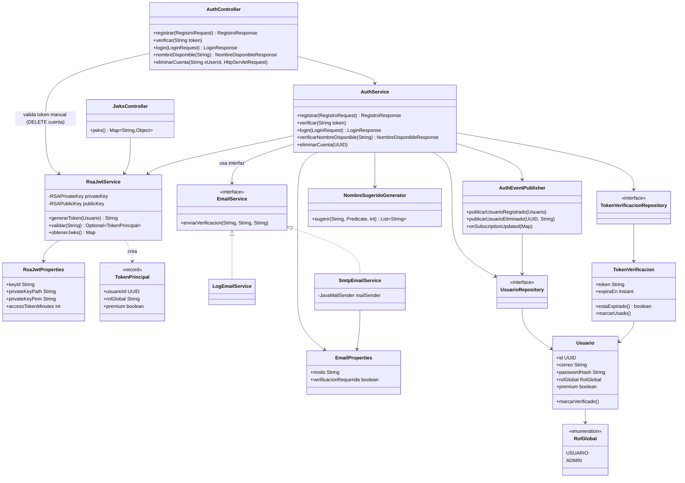

# ArtaGram Auth (`artagram-auth`)

Microservicio de identidad y autenticación de ArtaGram (`:8081`, base de datos `db_auth`).

## Responsabilidades
- Registro de artistas (`POST /api/auth/registro`), verificación de correo (`GET /api/auth/verificar`) y disponibilidad de nombre (`GET /api/auth/nombre-disponible`).
- Inicio de sesión (`POST /api/auth/login`) con emisión de JWT asimétricos **RS256** (llave privada RSA 2048).
- Exposición del conjunto de llaves públicas en `GET /.well-known/jwks.json` para que `artagram-gateway` y `artagram-lienzo` verifiquen firmas sin compartir secretos simétricos.
- Publicación de eventos de ciclo de vida en RabbitMQ (`artagram.events`):
  - `user.registered`
  - `user.deleted`
- Sincronización del estado `premium` consumiendo `subscription.updated` en la cola `auth.subscription.updated`.

## Diseño y Arquitectura

### Descripción

`artagram-auth` es el emisor único de identidad del sistema: registra artistas, valida credenciales y firma JWT **RS256** (asimétrico) que el resto de los microservicios verifica localmente contra la llave pública expuesta en `/.well-known/jwks.json` — nadie más que este servicio necesita conocer la llave privada. La capa de dominio (`Usuario`, `TokenVerificacion`) es delgada y persistente vía JPA; la lógica de negocio vive en `AuthService`, que orquesta validación, hashing de contraseña (`PasswordEncoder`), emisión de token (`RsaJwtService`) y notificación de eventos (`AuthEventPublisher`) sin conocer los detalles de implementación de ninguno.

### Principios SOLID

- **SRP** — Parcialmente cumplido. `AuthService` agrupa 5 casos de uso del ciclo de vida de la cuenta (registro, verificación, login, disponibilidad de nombre, eliminación); es cohesivo pero ya es candidato a dividirse en comandos si crece. `RsaJwtService` es el caso más claro de mezcla de responsabilidades: carga/generación de llaves, emisión, validación y serialización JWKS conviven en una sola clase. `AuthEventPublisher` mezcla el rol de *publisher* (`publicarUsuarioRegistrado/Eliminado`) con el de *listener* (`onSubscriptionUpdated`) — el nombre de la clase ya no describe todo lo que hace.
- **OCP** — Bien resuelto con `EmailService`: `LogEmailService` y `SmtpEmailService` implementan la misma interfaz y se activan por `@ConditionalOnProperty(app.email.mode)`; agregar un proveedor nuevo (p. ej. Amazon SES) no toca `AuthService` ni ninguna otra clase existente.
- **LSP** — Sin violaciones: ambas implementaciones de `EmailService` cumplen el mismo contrato (mismo método, mismas precondiciones) y son intercambiables sin sorpresas.
- **ISP** — `EmailService` es una interfaz de un solo método; no hay interfaces infladas forzando implementaciones vacías.
- **DIP** — `AuthService` depende de abstracciones inyectadas (`EmailService`, `PasswordEncoder`) vía constructor, no de implementaciones concretas — buen desacople. La excepción es `RsaJwtService`: `AuthService` y `AuthController` dependen de la clase concreta (no existe una interfaz `JwtService`), así que cambiar el algoritmo de firma exigiría tocar la clase en uso, no solo añadir una implementación nueva. Es una decisión razonable dado que RS256 + JWKS es una decisión arquitectónica estable, pero vale la nota.

### Puntos de extensibilidad

- **Proveedor de correo** (`EmailService`): agregar SES/SendGrid/etc. es implementar la interfaz + anotar con `@ConditionalOnProperty`, sin tocar código existente.
- **Disponibilidad de nombre de artista** (`NombreSugeridoGenerator.sugerir`): recibe un `Predicate<String>` como criterio de disponibilidad — el generador no sabe nada de JPA ni de `UsuarioRepository`, lo que lo hace testeable en aislamiento y reutilizable si otro servicio necesita sugerencias de nombre.
- **Origen de las llaves RSA** (`RsaJwtProperties`/`RsaJwtService`): soporta PEM inline por variable de entorno, archivo en disco, o generación efímera en memoria como última red de seguridad en desarrollo — las tres rutas ya están pensadas para no depender de un archivo montado en producción.
- Nota de diseño: `SecurityConfig` registra una `SecurityFilterChain` que permite todas las rutas (`anyRequest().permitAll()`) — Spring Security aquí solo aporta el `PasswordEncoder` (BCrypt) y la política de sesión *stateless*; la única autorización real (`DELETE /api/auth/cuenta`) se resuelve a mano en `AuthController.resolverUsuarioAutenticado`. Es intencional (el filtrado de rutas públicas/privadas vive en el gateway), pero es una dependencia que hoy no hace su trabajo habitual de autorización.

### Preparación para AWS

- **Base de datos**: `db_auth` migra directo a una instancia (o esquema) de **Amazon RDS for PostgreSQL**; no hay SQL propietario, Flyway corre igual contra RDS.
- **Llaves RSA — el cambio más importante**: hoy se montan como archivos (`jwt-private.pem`/`jwt-public.pem`) vía un volumen de Docker. En AWS, usar **AWS Secrets Manager** (o Parameter Store con `SecureString`) para inyectar `JWT_PRIVATE_KEY_PEM`/`JWT_PUBLIC_KEY_PEM` como variables de entorno en el *task definition* de ECS — `RsaJwtService.resolverPem` ya prioriza el valor inline sobre el archivo, así que no se necesita tocar código, solo dejar de montar el volumen. Planificar rotación: el `kid` en el JWKS permite tener más de una llave activa durante una rotación si se extiende `obtenerJwks()` a una lista.
- **RabbitMQ**: cambiar a **Amazon MQ (RabbitMQ)** es solo variables de conexión (`RABBITMQ_HOST`, credenciales desde Secrets Manager); el broker lógico (`artagram.events`, colas `auth.subscription.updated`) no cambia.
- **Stateless por diseño**: `SessionCreationPolicy.STATELESS` + JWT sin estado en servidor significa que `artagram-auth` escala horizontalmente sin *sticky sessions* — ideal para un Auto Scaling Group de ECS/Fargate detrás de un ALB.
- **Secretos adicionales a externalizar**: `DB_PASSWORD`, credenciales SMTP si se activa `app.email.mode=smtp` — todos ya se leen de variables de entorno, listos para Secrets Manager.
